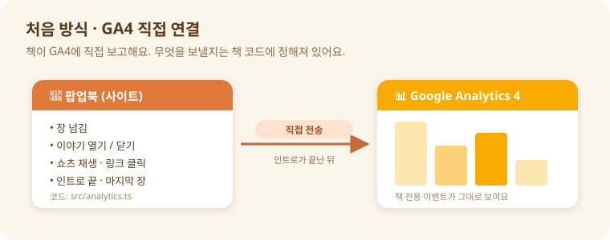
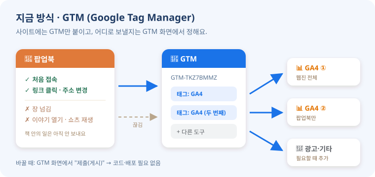
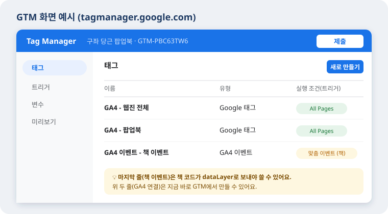
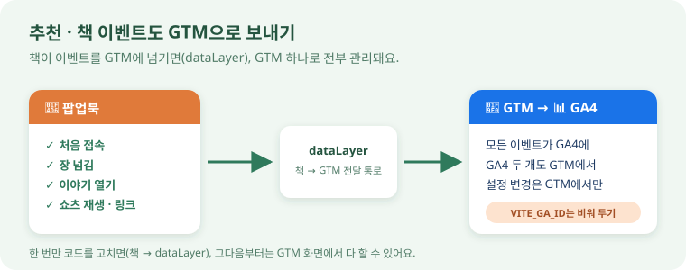

# 방문 기록(분석) 연결 방법 한눈에 보기

> **한 줄 요약**
> 처음 방식은 **책이 GA4에 직접** 보고하는 것이고, 지금 방식은 **GTM이라는 관리자를 중간에 두는 것**이에요.
> 이제 책 안에서 일어나는 일(장 넘김, 이야기 열기, 버튼 누름, 쇼츠 재생까지)도 **전부 GTM으로 전달돼요.** (아래 3번 · 4번)

---

## 비유로 이해하기

| | 비유 | 핵심 |
|---|---|---|
| **처음 방식 (GA4 직접)** | 가게 주인(책)이 **본사(GA4)에 직접 장부를 보냄** | 무엇을 적을지 주인이 정해 둠. 바꾸려면 주인(코드)을 고쳐야 함 |
| **지금 방식 (GTM)** | 가게 앞에 **관리 사무소(GTM)** 를 둠 | 장부를 어디로 보낼지 사무소에서 정함. 다만 가게 안 일은 주인이 사무소에 알려줘야 함 |

---

## 1. 처음 방식 · GA4 직접 연결

- 책 코드(`src/analytics.ts`)가 **GA4에 직접** 보내요.
- 보내는 것: 장 넘김, 이야기 열기·닫기, 쇼츠 재생, 링크 클릭, 인트로 완료, 마지막 장 도착
- 인트로가 끝난 뒤에 불러와서 **첫 화면이 느려지지 않아요.**
- 대신 **측정 ID를 바꾸거나 추가하려면 코드 수정 → 다시 배포**가 필요해요.
- 켜는 방법: 빌드할 때 `VITE_GA_ID`에 GA4 측정 ID(`G-…`)를 넣어요. **지금은 비어 있어서 꺼져 있어요.**

---

## 2. 지금 방식 · GTM (Google Tag Manager)

- 사이트에는 GTM 코드(`GTM-TKZ7BMMZ`) **하나만** 붙어 있어요. (`index.html`)
- **어디로 보낼지는 GTM 화면에서** 정해요. GA4 하나, GA4 두 개, 광고 도구까지 모두요.
- 바꿀 때는 GTM 화면에서 **"제출(게시)"만** 누르면 돼요. **코드·배포가 필요 없어요.**
- ⚠️ 하지만 GTM은 **책 안에서 일어나는 일을 스스로 알 수 없어요.**
  - ✅ 잡히는 것: 처음 접속, 링크 클릭, 주소 변경
  - ❌ 안 잡히는 것: 장 넘김, 이야기 열기, 쇼츠 재생

### GTM 화면은 이렇게 생겼어요

- **태그** = "무엇을 할지" (예: GA4로 보내기)
- **트리거** = "언제 할지" (예: All Pages = 모든 페이지가 열릴 때)
- 위 두 줄(GA4 연결)은 **지금 바로** GTM에서 만들 수 있어요.
- 마지막 줄(책 이벤트)은 **책 코드가 GTM에 알려줘야** 만들 수 있어요. → 3번 참고

---

## 3. 추천 · 책 이벤트도 GTM으로 보내기 ✅ 적용 완료

- 책 코드를 고쳐서 장 넘김, 이야기 열기, 버튼 누름, 쇼츠 재생이 **모두** GTM으로 전달돼요. (`src/analytics.ts`, `src/youtube.ts`)
  - 전달 통로 이름이 `dataLayer`예요.
- 이제부터는 **GTM 화면에서 전부 관리**할 수 있어요.
- 이때 **`VITE_GA_ID`는 비워 두세요.**
  - 책이 GA4에 직접 보내고, GTM도 같은 GA4에 보내면 **숫자가 두 번** 세어져요.

---

## 한눈에 비교

| | 처음 방식 (GA4 직접) | 지금 방식 (GTM) | 추천 (GTM + 책 이벤트) |
|---|:---:|:---:|:---:|
| 설정 바꾸는 곳 | 코드 + 배포 | GTM 화면 | GTM 화면 |
| 처음 접속 | ✅ | ✅ | ✅ |
| 장 넘김 · 이야기 열기 · 쇼츠 재생 | ✅ | ❌ | ✅ |
| 모든 버튼·링크 누름, 쇼츠 시청 25·50·75·100% | ❌ | ❌ | ✅ |
| GA4 두 개 · 다른 도구 추가 | 코드 수정 필요 | ✅ 바로 | ✅ 바로 |
| 불러오는 시점 | 인트로 끝난 뒤 | 페이지 열자마자 | 페이지 열자마자 |
| 지금 상태 | 꺼져 있음 (ID 없음) | — | **적용됨** (`main`에 합친 뒤) |

---

## 4. 무엇이 기록되나 (이벤트 목록)

모든 이벤트에는 **어느 장에서**(`book_chapter`: farmer · cooks · recipes), **어느 언어로**(`book_lang`: ko · en · zh), **휴대폰인지**(`book_layout`: phone · desktop), **어느 사이트에서**(`book_env`: main · test, `book_host`: 사이트 주소)가 함께 붙어요.

### 메인과 테스트 사이트 구분

| 사이트 | `book_env` | `book_host` |
|---|---|---|
| https://lxwebzine.hankyung.com/2026-1/team5/ (메인) | `main` | `lxwebzine.hankyung.com` |
| https://yigd-96.github.io/PopupBook/ (테스트) | `test` | `yigd-96.github.io` |
| Vercel 등 다른 곳, 내 컴퓨터 미리보기 (테스트) | `test` | 그 주소 |

GTM 코드가 모든 빌드에 같이 들어 있어서 **테스트 사이트도 같은 GA4에 기록돼요.** 보고서에서 나눠 보려면:
- GA4 보고서 위 **비교 추가 → `book_env` = `main`** (맞춤 측정기준 등록 후) — 또는 기본 제공 **호스트 이름**(Hostname)으로 나눠 봐도 돼요.
- 테스트를 아예 다른 GA4로 보내고 싶으면 GTM 트리거에 조건 `DLV - book_env` 같음 `test`를 넣어 태그를 나누면 돼요.

| 이벤트 | 언제 | 함께 오는 정보 |
|---|---|---|
| `page_view` | 장·이야기·마지막 장이 화면에 나올 때 | 주소(`#farmer`, `#recipes/poster-gnocchi` …), 제목 |
| `prologue_start` | "책장 속으로"를 눌렀을 때 | |
| `intro_complete` · `intro_skip` | 인트로 영상이 끝났을 때 / 건너뛰었을 때 | 화면 형태, 끊긴 프레임 수 |
| `guide_start` · `guide_done` | 사용법 안내가 시작·끝났을 때 | |
| `page_turn` | 책장을 넘겼을 때 | 어느 장 → 어느 장, 다음/이전, 방법(화살표·키·드래그·휠·링크) |
| `select_content` | 그림을 눌러 이야기(가게·메모 등)를 열었을 때 | 이야기 ID, 어디서 열었는지 |
| `story_close` | 이야기를 닫았을 때 | 이야기 ID, 열어 둔 시간(초) |
| **`ui_click`** | **어떤 버튼·링크든 눌렀을 때** | 버튼 글자(`ui_label`), 종류, **화면 위치**(`ui_area`: header · settings · contents · prologue · guide · poster_book · webzine · story_book · story_panel · ending …), 누르기 전 상태(열림/닫힘·선택됨) |
| `story_link_click` | 바깥 링크를 눌렀을 때 | 링크 주소, 글자, 위치 |
| `language_change` | 언어를 바꿨을 때 | 새 언어, 이전 언어 |
| `shorts_play` · `shorts_open` | 쇼츠 재생 버튼 / "YouTube에서 보기"를 눌렀을 때 | 레시피 ID |
| **`video_start` · `video_progress` · `video_complete` · `video_pause`** | **쇼츠를 실제로 본 정도** (시작, 25·50·75%, 끝까지, 멈춤) | 영상 제목·주소·길이, 본 위치(초), 비율(%) |
| `story_complete` · `restart` · `about_open` | 마지막 장 도착 / 처음부터 다시 / 목차 열기 | 연 이야기 수 |

---

## 5. GTM 설정하기 (한 번만)

### 가장 쉬운 방법: 준비된 파일 가져오기

같은 폴더의 **`gtm-container-popupbook.json`** 에 필요한 설정이 전부 들어 있어요.

1. tagmanager.google.com → 이 컨테이너(`GTM-TKZ7BMMZ`) → **관리 → 컨테이너 가져오기**
2. 파일: `gtm-container-popupbook.json` 선택 → 작업공간: **기존** → 가져오기 옵션: **병합 → 충돌하는 항목 이름 바꾸기** → 확인
3. 측정 ID는 **이미 들어 있어요**: 변수 `GA4 측정 ID 1` = `G-4CS8825LHN`, `GA4 측정 ID 2` = `G-RM4BJ9MT1R`
   (나중에 바꾸려면 이 변수 값만 고치면 돼요. GA4 → 관리 → 데이터 스트림에서 확인)
4. 오른쪽 위 **미리보기**로 확인한 뒤 **제출**

가져오면 생기는 것 (GA4 두 곳에 똑같이 보내요):
- 태그 `Google 태그 - GA4 1 (G-4CS8825LHN)`, `Google 태그 - GA4 2 (G-RM4BJ9MT1R)` — 모든 페이지에서 각 GA4 연결 (자동 페이지뷰는 꺼 둠: 책이 장마다 직접 보내요)
- 태그 `GA4 이벤트 - 팝업북 전부 → 1`, `… → 2` — 위 표의 이벤트를 **이름 그대로** 각 GA4로, 함께 오는 정보도 전부 붙여서
- 트리거 `팝업북 이벤트 (전부)`, 변수 `GA4 측정 ID 1·2`, `DLV - …` 38개

> 가져오기가 실패하면 아래 "직접 만들기"대로 하면 같은 결과예요.

### 직접 만들기

1. **변수 → 새로 만들기 → 데이터 영역 변수**: 이름 `DLV - ui_label`, 데이터 영역 변수 이름 `ui_label` … 필요한 정보마다 하나씩
2. **트리거 → 새로 만들기 → 맞춤 이벤트**: 이벤트 이름 `^(page_view|ui_click|select_content|page_turn|video_start|video_progress|video_complete|…)$`, **정규 표현식 일치 사용** 체크
3. **태그 → Google 태그**: 태그 ID = GA4 측정 ID, 설정 매개변수 `send_page_view` = `false`, 트리거 **All Pages**
4. **태그 → Google 애널리틱스: GA4 이벤트**: 측정 ID = GA4 측정 ID, 이벤트 이름 = `{{Event}}`, 이벤트 매개변수에 `ui_label` = `{{DLV - ui_label}}` … , 트리거 = 2번

### GA4에서 보이게 하기

GA4 보고서에서 "어떤 버튼을 눌렀는지" 같은 정보를 칸으로 보려면 **맞춤 측정기준**으로 등록해요.
GA4 → 관리 → **맞춤 정의 → 맞춤 측정기준 만들기** (범위: 이벤트)

| 등록 추천 | 의미 |
|---|---|
| `ui_label`, `ui_area` | 무슨 버튼을, 화면 어디서 눌렀는지 |
| `content_id` | 어떤 이야기·레시피였는지 |
| `book_chapter`, `book_lang`, `book_layout` | 어느 장, 어느 언어, 휴대폰인지 |
| `book_env`, `book_host` | 메인(lxwebzine)인지 테스트 사이트인지, 어느 주소인지 |
| `video_title`, `video_percent` | 어떤 쇼츠를 몇 %까지 봤는지 |
| `method`, `source` | 책장을 어떻게 넘겼는지, 이야기를 어떻게 열었는지 |

---

## 지금 해야 할 일

1. **코드를 사이트에 반영하기** — 이번 변경을 커밋해 `main`에 합치면 1~2분 뒤 사이트에 들어가요.
2. **GTM 설정** — 위 5번(파일 가져오기 → 측정 ID 바꾸기 → 제출)
3. **GA4에서 중복 막기** — **두 GA4 모두**에서: 관리 → 데이터 스트림 → 향상된 측정 → **"브라우저 기록 이벤트 기반 페이지 변경" 끄기**
4. **`VITE_GA_ID`는 비워 두기** — GTM과 같은 GA4에 직접 연결까지 하면 숫자가 두 번 세어져요.
5. **맞춤 측정기준 등록** — 위 표 참고 (두 GA4 각각 따로 등록해요)

---

## 잘 들어오는지 확인하는 법

- **GTM**: 상단 **미리보기** → 사이트 주소 입력 → 책에서 버튼을 눌러 보면 왼쪽에 `ui_click`, `page_turn` 같은 이벤트가 쌓이고, 태그가 "Fired(실행됨)"로 나오면 성공
- **GA4**: 보고서 → **실시간** → 사이트를 열면 1분 안에 내 방문이 보여요.
